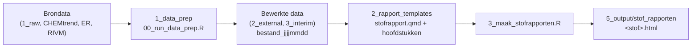

# KRWstofkompas
Reproducible workflow for identifying and prioritizing KRW problem substances by integrating water quality monitoring, trend analysis, emission inventories and source information. Supports annual reporting, prioritisation, uncertainty assessment and recommendations for monitoring, research and measures.

## Workflow

De workflow bestaat uit drie stappen: data voorbewerken, rapporttemplates en per stof een rapport renderen.



### Mappenstructuur

```
scripts/
  0_algemeen/              gedeelde code, door alle stappen gebruikt
    setup.R                laadt alle packages en sourcet paths.R, functies.R en rivm_stofgegevens.R
    paths.R                paden naar de projectdata op de P-schijf
    functies.R             hulpfuncties, o.a. nieuwste_bestand() en lees_gis()
    rivm_stofgegevens.R    ophalen van stofgegevens bij het RIVM
  1_data_prep/             stap 1: brondata inlezen, formatteren en wegschrijven
    00_run_data_prep.R     draait alle 01-scripts op volgorde
    01a_read_format_normen_RIVM.R
    01b_read_format_chemtrend.R      trendconclusies, meetpuntlocaties en lowess-trendlijnen
    01c_read_gis_data.R              stroomgebieden en waterlichamen (vereenvoudigd)
    01d_read_toetsoordelen_wkp.R
    01e_read_format_ER.R             emissieregistratie
  2_rapport_templates/     stap 2: templates van het stofrapport
    stofrapport.qmd        hoofdrapport; neemt de hoofdstukken op
    01_stofinformatie.qmd
    02_toestandsoordelen.qmd
    03_trends.qmd
    04_bronnen.qmd         nog in ontwikkeling, niet opgenomen in het rapport
    stofrapport.css        huisstijl
  3_maak_stofrapporten.R   stap 3: rendert een stofrapport per stof
```

### Stap 0 – Packages met uvr

Dit project gebruikt [uvr](https://github.com/nbafrank/uvr) voor R-packages: één manifest, één lockfile en een eigen packagebibliotheek per project. Iedereen die het project draait, gebruikt daardoor exact dezelfde packageversies.

| Bestand | Wat | In git? |
|---|---|---|
| `uvr.toml` | Manifest: R-versie en de packages die het project direct gebruikt | ja |
| `uvr.lock` | Lockfile: exacte versies van alle packages, inclusief afhankelijkheden | ja |
| `.uvr/library/` | Projectbibliotheek waarin de packages geïnstalleerd worden | nee |
| `.Rprofile` | Gemaakt door uvr; zet `.uvr/library` vooraan in `.libPaths()` bij het starten van R in de projectmap | ja |

#### Eerste keer installeren

1. Installeer uvr (eenmalig per computer, geen adminrechten nodig). In PowerShell:

   ```powershell
   irm https://raw.githubusercontent.com/nbafrank/uvr/main/install.ps1 | iex
   ```

   uvr komt in `~/.local/bin`. Open daarna een nieuwe terminal en controleer met `uvr --version`.

2. Installeer de packages vanuit de projectmap:

   ```
   uvr sync
   ```

   Dit installeert alle packages uit `uvr.lock` als binaries in `.uvr/library` (eerste keer ca. 5 minuten, daarna vrijwel direct vanuit de cache).

3. Controleer in R (gestart vanuit de projectmap) dat de projectbibliotheek actief is. Bij het opstarten verschijnt `uvr: library linked (… packages)` en `.libPaths()[1]` wijst naar `.uvr/library`.

#### Dagelijks gebruik

| Situatie | Commando |
|---|---|
| Na een `git pull` waarin `uvr.lock` is gewijzigd | `uvr sync` |
| Nieuw package nodig | `uvr add <package>` (werkt `uvr.toml` en `uvr.lock` bij en installeert) |
| Package van GitHub | `uvr add eigenaar/repo` |
| Package niet meer nodig | `uvr remove <package>` |
| Packages bijwerken naar nieuwste versies | `uvr update` (of eerst `uvr update --dry-run`) |
| Overzicht van afhankelijkheden | `uvr tree --depth 1` |
| Problemen opsporen | `uvr doctor` |

Commit na `uvr add`, `uvr remove` of `uvr update` altijd zowel `uvr.toml` als `uvr.lock`.

#### Afspraken

- Installeer packages niet met `install.packages()`, maar met `uvr add`. Een package dat niet in `uvr.toml` staat, kan nog stilletjes uit je persoonlijke R-bibliotheek geladen worden; het werkt dan bij jou, maar niet bij anderen.
- Packages die in (bijna) alle scripts nodig zijn, worden geladen in `scripts/0_algemeen/setup.R`. Overige packages roep je aan als `pkg::functie()`, zodat zichtbaar blijft waar ze vandaan komen.
- De R-versie staat in `uvr.toml` (`r_version`). Wil je die per project vastzetten, gebruik dan `uvr r install <versie>` en `uvr r pin <versie>`; dat schrijft een `.r-version`-bestand.

### Stap 1 – Data voorbewerken

```
Rscript scripts/1_data_prep/00_run_data_prep.R
```

Elk 01-script leest brondata in, formatteert die en schrijft het resultaat weg naar `data/2_external` of `data/3_interim`, met de datum van de run in de bestandsnaam (bijv. `toestand_wkp_20261019.parquet`). De rapporten lezen altijd de nieuwste versie via `nieuwste_bestand()`. Draai deze stap opnieuw als er nieuwe brondata is; losse 01-scripts kunnen ook apart gedraaid worden.

### Stap 2 – Rapporttemplates

`stofrapport.qmd` is het hoofdrapport met als parameters `stof`, `heeft_toestand` en `heeft_trend`. Het neemt de hoofdstukken op; heeft een stof geen toestandsoordelen of trenddata, dan toont dat hoofdstuk een melding. De hoofdstukken lezen alleen bewerkte data (gefilterd op de stof) en kunnen ook los gerenderd worden om te controleren; ze gebruiken dan de voorbeeldstof die bovenin staat.

Een nieuw hoofdstuk toevoegen:

1. Maak `0x_<naam>.qmd` in `2_rapport_templates/` met bovenaan `if (!exists("paths")) source(here::here("scripts", "0_algemeen", "setup.R"))`.
2. Lees alleen bewerkte data uit stap 1; voeg zo nodig een 01-script toe.
3. Neem het hoofdstuk op in `stofrapport.qmd`.

### Stap 3 – Stofrapporten maken

```
Rscript scripts/3_maak_stofrapporten.R
```

Maakt een rapport voor elke stof in de toestandsoordelen of CHEMtrend en schrijft dat naar `data/5_output/stof_rapporten/<stof>.html`. Mislukt een stof, dan gaat het script door en meldt aan het eind welke stoffen mislukt zijn.
