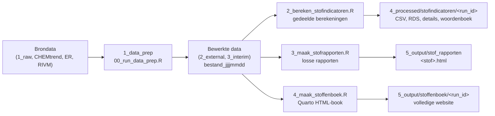

# KRWstofkompas
Reproducible workflow for exploring KRW problem substances by integrating water quality assessments, trend analysis, emission inventories and source information. Shared indicators support annual reporting and further analysis; no priority score or weighting model is implemented.

**Huidige testfase:** de boekgenerator verwerkt standaard alleen As, Cd, Pb en
PFOS. Pas `test_stoffen` aan in het boekscript; `selectie = NULL` exporteert alle
stoffen. De lokale proefboeken blijven per run bewaard en worden niet in Git opgenomen.
## Workflow

De workflow bestaat uit data voorbewerken, gedeelde stofindicatoren berekenen en vervolgens losse stofrapporten en/of een Quarto HTML-stoffenboek maken. Het boek opent met een doorzoekbare, sorteerbare indicatorentabel en bevat daarna een hoofdstuk per stof. De beginvolgorde is alfabetisch, geen wetenschappelijke prioriteitsrangschikking.



De rapport- en boekdrivers maken zelf een verse indicatorenexport met vastgezette bronbestanden. Stap 2 is dus ook zelfstandig bruikbaar voor alleen de cijfers; stap 3 is geen vereiste voor stap 4.

### Mappenstructuur

```
scripts/
  0_algemeen/              gedeelde code, door alle stappen gebruikt
    setup.R                laadt rapportpackages en gedeelde helpers
    paths.R                paden naar de projectdata op de P-schijf
    functies.R             hulpfuncties, o.a. nieuwste_bestand() en lees_gis()
    rivm_stofgegevens.R    ophalen van stofgegevens bij het RIVM
    stofindicatoren.R      pure samenvattingen, bronselectie en CSV/RDS-export
    stoffenboek.R          generatie en publicatie van een Quarto HTML-book
  1_data_prep/             stap 1: brondata inlezen, formatteren en wegschrijven
    00_run_data_prep.R     draait alle 01-scripts op volgorde
    01a_read_format_normen_RIVM.R
    01b_read_format_chemtrend.R      trendconclusies, meetpuntlocaties en lowess-trendlijnen
    01c_read_gis_data.R              stroomgebieden en waterlichamen (vereenvoudigd)
    01d_read_toetsoordelen_wkp.R
    01e_read_format_ER.R             emissieregistratie
  2_bereken_stofindicatoren.R  stap 2: indicatoren exporteren, zonder rapporten
  2_rapport_templates/     gedeelde templates voor losse rapporten en het boek
    stofrapport.qmd        hoofdrapport; neemt de hoofdstukken op
    00_rangschikking.qmd    openingstabel van het boek, zonder prioriteitsscore
    00_samenvatting.qmd     gedeelde samenvatting van toestand, trends en emissies
    01_stofinformatie.qmd
    02_toestandsoordelen.qmd
    03_trends.qmd
    04_bronnen.qmd         emissies en bronnen; opgenomen bij beschikbare emissiedata
    stofrapport.css        huisstijl
  3_maak_stofrapporten.R   stap 3: rendert een stofrapport per stof
  4_maak_stoffenboek.R     stap 4: rendert en publiceert het volledige stoffenboek
tests/
  testthat.R               lichte testrunner, zonder setup.R
  testthat/
    test-stofindicatoren.R pure fixtures en boekgeneratie zonder render
_stoffenboek/<run_id>/     lokaal gegenereerd Quarto-project en renderuitvoer
```

### Stap 0 – Packages met uvr

Dit project gebruikt [uvr](https://github.com/nbafrank/uvr) voor R-packages: één manifest, één lockfile en een eigen packagebibliotheek per project. Iedereen die het project draait, gebruikt daardoor exact dezelfde packageversies.

| Bestand | Wat | In git? |
|---|---|---|
| `uvr.toml` | Manifest: R-versie en de packages die het project direct gebruikt | ja |
| `uvr.lock` | Lockfile: exacte versies van alle packages, inclusief afhankelijkheden | ja |
| `.uvr/library/` | Projectbibliotheek waarin de packages geïnstalleerd worden | nee |
| `.Rprofile` | Gemaakt door uvr; zet `.uvr/library` vooraan in `.libPaths()` bij het starten van R in de projectmap | ja |

#### Eerste keer installeren

1. Installeer uvr (eenmalig per computer, geen adminrechten nodig). In PowerShell:

   ```powershell
   irm https://raw.githubusercontent.com/nbafrank/uvr/main/install.ps1 | iex
   ```

   uvr komt in `~/.local/bin`. Open daarna een nieuwe terminal en controleer met `uvr --version`.

2. Installeer de packages vanuit de projectmap:

   ```
   uvr sync
   ```

   Dit installeert alle packages uit `uvr.lock` als binaries in `.uvr/library` (eerste keer ca. 5 minuten, daarna vrijwel direct vanuit de cache).

3. Controleer in R (gestart vanuit de projectmap) dat de projectbibliotheek actief is. Bij het opstarten verschijnt `uvr: library linked (… packages)` en `.libPaths()[1]` wijst naar `.uvr/library`.

#### Dagelijks gebruik

| Situatie | Commando |
|---|---|
| Na een `git pull` waarin `uvr.lock` is gewijzigd | `uvr sync` |
| Nieuw package nodig | `uvr add <package>` (werkt `uvr.toml` en `uvr.lock` bij en installeert) |
| Package van GitHub | `uvr add eigenaar/repo` |
| Package niet meer nodig | `uvr remove <package>` |
| Packages bijwerken naar nieuwste versies | `uvr update` (of eerst `uvr update --dry-run`) |
| Overzicht van afhankelijkheden | `uvr tree --depth 1` |
| Problemen opsporen | `uvr doctor` |

Commit na `uvr add`, `uvr remove` of `uvr update` altijd zowel `uvr.toml` als `uvr.lock`.

#### Afspraken

- Installeer packages niet met `install.packages()`, maar met `uvr add`. Een package dat niet in `uvr.toml` staat, kan nog stilletjes uit je persoonlijke R-bibliotheek geladen worden; het werkt dan bij jou, maar niet bij anderen.
- Packages die in (bijna) alle scripts nodig zijn, worden geladen in `scripts/0_algemeen/setup.R`. Overige packages roep je aan als `pkg::functie()`, zodat zichtbaar blijft waar ze vandaan komen.
- De R-versie staat in `uvr.toml` (`r_version`). Wil je die per project vastzetten, gebruik dan `uvr r install <versie>` en `uvr r pin <versie>`; dat schrijft een `.r-version`-bestand.

### Stap 1 – Data voorbewerken

```
Rscript scripts/1_data_prep/00_run_data_prep.R
```

Elk 01-script leest brondata in, formatteert die en schrijft het resultaat weg naar `paths$external` of `paths$interim`, met de datum van de run in de bestandsnaam. De paden staan in [scripts/0_algemeen/paths.R](scripts/0_algemeen/paths.R) en wijzen momenteel naar de projectdata op de P-schijf, niet naar een lokale data-map in deze repository. Draai deze stap opnieuw als er nieuwe brondata is; losse 01-scripts kunnen ook apart gedraaid worden.

### Stap 2 – Stofindicatoren berekenen

```sh
Rscript scripts/2_bereken_stofindicatoren.R
```

Dit levert `stofindicatoren` op: één rij per stof, met identificatie, beschikbaarheidsvlaggen, lokale RIVM-normen, toestand, trends en emissies. De stofselectie is de **unie van toestandsoordelen en CHEMtrend**. Stoffen die uitsluitend in de emissieregistratie of normen voorkomen worden niet toegevoegd. Eén aquo-code kan meerdere ER-codes vertegenwoordigen.

Elke export krijgt een nieuwe runmap onder `paths$processed/stofindicatoren/<run_id>/`:

```text
stofindicatoren.rds       getypeerde tibble met één rij per stof
stofindicatoren.csv       UTF-8 CSV, onopgemaakte numerieke kolommen
datadictionary.csv        kolomnamen, typen, eenheden en definities
normen_details.csv        normbronregels per stof
toestand_details.csv      toestandbronregels met jaren en classificaties
trends_details.csv        trendbronregels per aggregatieniveau en regio
emissies_details.csv      emissiebronregels per jaar, compartiment, eenheid en sector
bronbestanden.csv         gebruikte bronpaden en MD5-controlesommen
provenance.rds            bronselectie, controlesommen, tijdstip en stofselectie
```

De detailtabellen behouden de bronparameters; gebruik ze voor uitsplitsingen die niet in één indicatorenrij passen. Het woordenboek beschrijft de exportkolommen. Bronbestanden worden eenmaal per run gekozen met `nieuwste_bestand()` en na berekening gecontroleerd op wijzigingen. Een export vereist geen GIS-bewerkingen, RIVM-webscraping of Quarto-render.

#### Interpretatie en dekking

- **Toestand:** het meest recente geldige `Rapportagejaar` per stof. Aantallen en percentages tellen **oordelen**, niet unieke waterlichamen. De noemer bevat alle recente oordelen, inclusief niet-toetsbare, niet-van-toepassing en onbekende classificaties. Het aantal unieke niet-lege waterlichaamcodes staat apart. Oordelen zonder geldig jaar tellen niet mee in de recente selectie, maar worden wel gesignaleerd.
- **Trends:** bronregels vóór GIS-joins, afzonderlijk voor landelijk, stroomgebied, waterlichaam en meetpunt. `Geen trend` wordt `Geen significante trend`. Percentages gebruiken uitsluitend stijgende, dalende en niet-significante trends als noemer; onvoldoende/onbekende conclusies tellen niet mee. Dubbele regio's worden gesignaleerd, niet willekeurig verwijderd. Een GIS-locatie zonder brontrend is geen extra trendwaarneming.
- **Emissies:** het laatste geldige ER-jaar over riool en water samen is het gedeelde vergelijkingsjaar. Ontbreekt een compartiment in dat jaar, dan blijft zijn totaal `NA`; het laatst beschikbare compartimentjaar is alleen context, geen stille terugval naar een ouder totaal. Een totaal vereist één ingevulde eenheid en uitsluitend eindige, niet-negatieve emissiewaarden. Gemengde of ontbrekende eenheden en ontbrekende waarden geven geen betrouwbaar totaal; er vindt geen impliciete eenheidsconversie plaats. Controleer de eenheden in de bron/details bij vergelijking.
- **Compartimenten en sectoren:** riool en water blijven apart; optellen kan dubbeltellen. Gedeelde eerste plaatsen bij sectoren worden samen vermeld, alfabetisch. Het sectorpercentage geldt voor **elk** van die sectoren, niet voor hun gezamenlijke bijdrage. Bij een geldig totaal van nul is een aandeel niet berekenbaar.
- **Ontbrekend is niet nul:** `NA` betekent niet beschikbaar of niet berekenbaar; nul betekent een waargenomen nul. Percentages staan op de schaal 0–100. Beschikbaarheidsvlaggen geven aan of bronregels aanwezig zijn, niet of alle indicatoren geldig zijn.
- **Geen prioriteitsscore:** bronjaren en dekking verschillen tussen toestand, trends en emissies. De sorteerbare tabel is verkennend; ruwe emissiemassa is geen maat voor toxiciteit, risico of beleidsprioriteit. Er zijn geen gewichten of automatische rangschikkingsformule.

### Gedeelde rapporttemplates

[scripts/2_rapport_templates/stofrapport.qmd](scripts/2_rapport_templates/stofrapport.qmd) gebruikt de parameters `stof`, `heeft_toestand`, `heeft_trend` en `heeft_emissie`. De gedeelde samenvatting en hoofdstukken 01–04 worden zowel in losse rapporten als in het boek gebruikt. Bij ontbrekende gegevens verschijnt een melding. De emissiesectie 04 is dus wel opgenomen wanneer emissiedata beschikbaar zijn.

De optionele parameters `indicatoren_bestand` en `bronbestanden` laten een rapport dezelfde voorbereide indicatoren en bronselectie gebruiken als de driver. Zonder voorbereide indicatoren berekent de gedeelde helper alleen de gevraagde stof. Zelfstandig renderen van een stofrapport blijft ondersteund; de detailtemplates hebben voorbeeldinstellingen voor afzonderlijke controles. Bereken nieuwe cijfers in de gedeelde helpers, niet opnieuw in de templates.

### Stap 3 – Stofrapporten maken

```
Rscript scripts/3_maak_stofrapporten.R
```

Maakt zelf een verse indicatorenexport en vervolgens een rapport voor elke stof in de toestandsoordelen of CHEMtrend. Uitvoer staat onder `paths$output/stof_rapporten/` (stofcode als veilige HTML-bestandsnaam). Mislukt een stof, dan gaat het script door en meldt aan het eind welke stoffen mislukt zijn. Quarto rendert eerst lokaal omdat direct renderen naar een andere schijf beperkingen heeft. Bestaande losse rapporten kunnen worden overschreven.

### Stap 4 – Stoffenboek maken

```sh
Rscript scripts/4_maak_stoffenboek.R
```

Maakt een verse indicatorenexport, genereert een lokaal Quarto HTML-book en publiceert na succesvolle render en controles de **volledige website**. Stap 3 hoeft hiervoor niet te worden uitgevoerd. Quarto moet geïnstalleerd zijn; de geconfigureerde brondata en aanvullende kaart-/lijnbestanden moeten bereikbaar zijn.

```text
<repository>/_stoffenboek/<run_id>/              lokaal Quarto-project
<repository>/_stoffenboek/<run_id>/_book/        lokale website
<paths$output>/stoffenboek/<run_id>/index.html  gepubliceerde startpagina
<paths$output>/stoffenboek/<run_id>/downloads/  indicatoren en exportbijlagen
<paths$output>/stoffenboek/<run_id>/manifest.rds publicatiemanifest
```

Hoofdstukken hebben botsingsveilige bestandsnamen en stofgebonden labels/anchors. De openingstabel linkt naar de stofhoofdstukken en biedt de indicatoren-CSV als download. Zoekfunctie, navigatie en widgets horen bij de website: deel de hele publicatiemap, niet alleen de startpagina. Elke run gebruikt een nieuwe map; oude runs worden niet automatisch opgeruimd. Het publicatiemanifest wordt pas na een geslaagde kopie geschreven. Een voorbereide of mislukte render is geen gepubliceerde run.

Voor alleen generatie zonder render/publicatie kan `maak_stoffenboek(paths, root = here::here(), export = indicatoren_export, render = FALSE)` worden gebruikt na het laden van de gedeelde helpers. Dit vervangt geen volledige rendercontrole.

### Tests

Vanuit de repository, met de projectbibliotheek actief:

```sh
Rscript tests/testthat.R
```

[tests/testthat.R](tests/testthat.R) vindt de projectroot via `here::here()` en sourcet uitsluitend de indicator- en boekhelpers, **niet** de zware rapportsetup. Benodigde packages zijn `testthat`, `here`, `tibble`, `dplyr` en `readr`; installeer/synchroniseer die via uvr volgens de packageafspraken hierboven.

[tests/testthat/test-stofindicatoren.R](tests/testthat/test-stofindicatoren.R) gebruikt complete kleine fixtures voor recente/ontbrekende toestand, oordeel- versus waterlichaamaantallen, trendcategorieën/noemers/dubbele regio's, emissiejaren/eenheden/ontbrekende waarden/nul/sector-ties, stofselectie en gedeelde indicatoren. Een lokale boekfixture test generatie met botsende stofcodes, hoofdstuklabels en interne verwijzingen met `render = FALSE`.

Deze tests hebben geen P-schijf, Arrow, GIS, RIVM-website of Quarto nodig. Ze vervangen geen integratietest met echte bronbestanden en een volledig gerenderd boek; controleer daarbij ook kaarten, widgets, downloads en navigatie.
