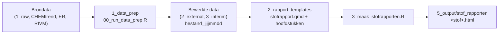

# KRWstofkompas
Reproducible workflow for identifying and prioritizing KRW problem substances by integrating water quality monitoring, trend analysis, emission inventories and source information. Supports annual reporting, prioritisation, uncertainty assessment and recommendations for monitoring, research and measures.

## Workflow

De workflow bestaat uit drie stappen: data voorbewerken, rapporttemplates en per stof een rapport renderen.



### Mappenstructuur

```
scripts/
  0_algemeen/              gedeelde code, door alle stappen gebruikt
    setup.R                laadt alle packages en sourcet paths.R, functies.R en rivm_stofgegevens.R
    paths.R                paden naar de projectdata op de P-schijf
    functies.R             hulpfuncties, o.a. nieuwste_bestand() en lees_gis()
    rivm_stofgegevens.R    ophalen van stofgegevens bij het RIVM
  1_data_prep/             stap 1: brondata inlezen, formatteren en wegschrijven
    00_run_data_prep.R     draait alle 01-scripts op volgorde
    01a_read_format_normen_RIVM.R
    01b_read_format_chemtrend.R      trendconclusies, meetpuntlocaties en lowess-trendlijnen
    01c_read_gis_data.R              stroomgebieden en waterlichamen (vereenvoudigd)
    01d_read_toetsoordelen_wkp.R
    01e_read_format_ER.R             emissieregistratie
  2_rapport_templates/     stap 2: templates van het stofrapport
    stofrapport.qmd        hoofdrapport; neemt de hoofdstukken op
    01_stofinformatie.qmd
    02_toestandsoordelen.qmd
    03_trends.qmd
    04_bronnen.qmd         nog in ontwikkeling, niet opgenomen in het rapport
    stofrapport.css        huisstijl
  3_maak_stofrapporten.R   stap 3: rendert een stofrapport per stof
```

### Stap 0 – Packages

Alle packages staan in `uvr.toml` en worden geïnstalleerd met [uvr](https://github.com/nbafrank/uvr):

```
uvr sync
```

Packages worden op één plek geladen in `scripts/0_algemeen/setup.R`; overige packages worden aangeroepen als `pkg::functie()`. Een nieuw package voeg je toe met `uvr add <package>`.

### Stap 1 – Data voorbewerken

```
Rscript scripts/1_data_prep/00_run_data_prep.R
```

Elk 01-script leest brondata in, formatteert die en schrijft het resultaat weg naar `data/2_external` of `data/3_interim`, met de datum van de run in de bestandsnaam (bijv. `toestand_wkp_20261019.parquet`). De rapporten lezen altijd de nieuwste versie via `nieuwste_bestand()`. Draai deze stap opnieuw als er nieuwe brondata is; losse 01-scripts kunnen ook apart gedraaid worden.

### Stap 2 – Rapporttemplates

`stofrapport.qmd` is het hoofdrapport met als parameters `stof`, `heeft_toestand` en `heeft_trend`. Het neemt de hoofdstukken op; heeft een stof geen toestandsoordelen of trenddata, dan toont dat hoofdstuk een melding. De hoofdstukken lezen alleen bewerkte data (gefilterd op de stof) en kunnen ook los gerenderd worden om te controleren; ze gebruiken dan de voorbeeldstof die bovenin staat.

Een nieuw hoofdstuk toevoegen:

1. Maak `0x_<naam>.qmd` in `2_rapport_templates/` met bovenaan `if (!exists("paths")) source(here::here("scripts", "0_algemeen", "setup.R"))`.
2. Lees alleen bewerkte data uit stap 1; voeg zo nodig een 01-script toe.
3. Neem het hoofdstuk op in `stofrapport.qmd`.

### Stap 3 – Stofrapporten maken

```
Rscript scripts/3_maak_stofrapporten.R
```

Maakt een rapport voor elke stof in de toestandsoordelen of CHEMtrend en schrijft dat naar `data/5_output/stof_rapporten/<stof>.html`. Mislukt een stof, dan gaat het script door en meldt aan het eind welke stoffen mislukt zijn.
